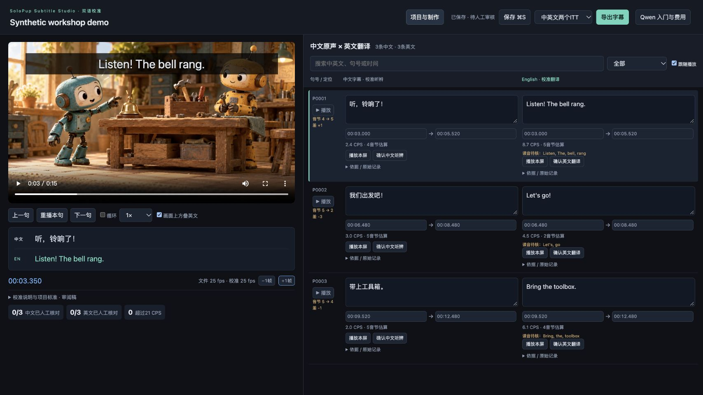
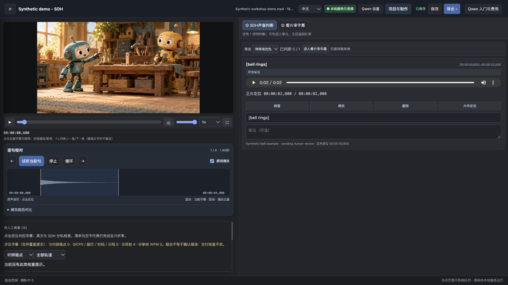
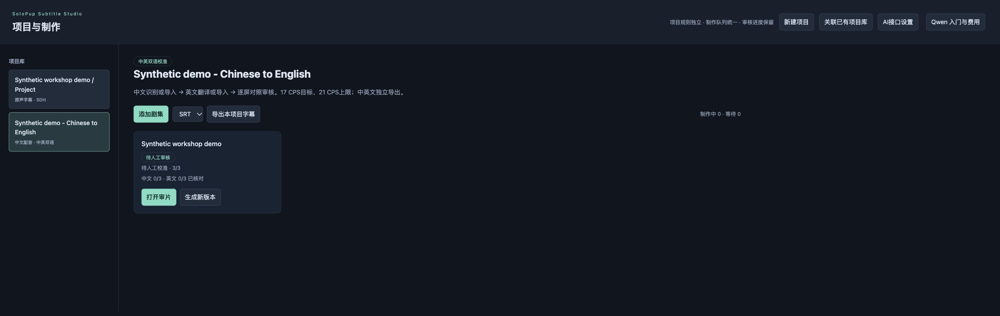

# SoloPup Subtitle Studio

[CI configuration](docs/ci/checks.yml) · [MIT](LICENSE) · [Download](https://github.com/OakcoderX/solopup-subtitle-studio/releases) · [Website](https://oakcoderx.github.io/solopup-subtitle-studio/)

**由 SoloPup 开发的本地字幕工作台，核心亮点是 SDH 无障碍字幕制作，以及保留中文配音的英文字幕本地化。**

[English](README.md) · [快速开始](docs/QUICKSTART.md) · [编程助手规则](AGENTS.md)

把转写、翻译、校时、审核和导出放进同一个项目。你可以制作普通字幕和SDH无障碍字幕，也可以保留中文配音，在同屏校对中文字幕与英文译文。每条字幕都能回到原片查看，修改与审核有记录。

SoloPup在本机运行，通过浏览器操作。可以直接使用编辑器，也可以让Codex协助整理素材、生成初稿和检查问题。导入已有字幕、播放和人工校对不需要AI账号。

## 先不配置 AI，体验预览版

[中文产品介绍](https://oakcoderx.github.io/solopup-subtitle-studio/zh.html) · [无 API Key 试用步骤](https://oakcoderx.github.io/solopup-subtitle-studio/try-offline.html) · [费用与隐私说明](https://oakcoderx.github.io/solopup-subtitle-studio/faq.html)

在 [v2.0.0-rc.5 发布页](https://github.com/OakcoderX/solopup-subtitle-studio/releases/tag/v2.0.0-rc.5)下载 **Public.zip** 资产，解压后按下方步骤启动。合成静音示例用于体验编辑，不代表识别质量。首次安装需下载依赖；已有字幕的本地审校无需云端 AI。

## 两大核心亮点

### SDH：把听见的故事，也写进字幕

SDH（Subtitles for the Deaf and Hard of Hearing）是面向聋人及听障观众的无障碍字幕，也是本系统最大的亮点之一。除对白与歌词外，还需要表达影响理解的说话人身份、重要音效、音乐及声音发生方式，让观众在无法充分听到声音时，也能理解情节与情绪。

工作台将普通字幕与 SDH 分轨组织，结合声音证据和人工复核，帮助判断哪些声音值得写、如何准确表述，以及何时出现和消失。字幕可回到原片逐条核对，并保留修改与审核记录。AI 提供候选，最终声音判断由审校者确认。

### 中文配音，英文字幕：跟着原声讲故事

面向保留中文配音、供英语观众观看的内容。先依据中文原声校准中文字幕，再逐屏翻译为英文；画面中可同时显示中英两轨，方便核对原文、翻译和时间。

英文屏幕切换尽量对应中文断句，跟随原声信息出现的顺序，在准确、自然的基础上尽量贴近中文发音的长度、节奏和音节。例如中文分两屏说完的一句话，英文也优先拆成对应的两屏，避免提前透露下一句的信息。

工作台显示音节估算与差值，辅助审校；这不是配音口型验证，也不强求每句音节完全相等。中英双语导入要求屏数和时码对应，两种语言分别导出 ITT 或 SRT 文件。

## 实际界面

以下均为工作台实际运行截图，使用合成演示数据。只有播放器中的场景画面由 AI 生成；按钮、字幕、读速、音节估算与审核状态均由程序真实显示。演示字幕为导入的示例文字，并非从演示音轨识别所得，不作为识别或翻译质量样本。截图使用中文操作界面。

### 中文配音 × 英文字幕



同时对照中文与英文，逐屏回放，查看读速和音节估算差异。示例保留待人工审核状态。

### SDH 声音判断



试听合成铃声候选，结合原声波形和片中定位，判断保留、修改或删除。声音候选判断与最终字幕批准分别处理。

### 项目管理与导出



按项目选择工作方式，保留中英文各自的审核进度，以 ITT 或 SRT 导出项目字幕。

## 从初稿到可审核的字幕

- 在统一项目页管理剧集和版本，每批加入1—5集，支持后台制作、暂停、重试和独立新稿。
- 看原片、逐句回放、循环片段、调整播放速度、按字幕编辑网格逐帧校准；中文与英文可以并排编辑和分别确认。
- 按项目保存的规则查看读速、行长、时长、间隔和重叠问题，分别记录原片帧率与字幕编辑帧率。
- 保存字幕及审核决定，旧页面不能悄悄覆盖别人或另一个窗口保存的新版本。
- 分轨导出ITT或SRT。中英字幕文件沿用原视频完整名称，加`.zh`和`.en`后缀，便于与视频配套使用。
- 查阅中、英、日、韩的原创MD规范摘要与实现状态，分清程序检查、人工判断和待实现能力。

## AI制作前先配置Qwen

AI识别、翻译和复核需要自己的Qwen API Key及模型权限。先核对适用的试用额度、测试小片段，再准备计费与预算做正式批量；通常同一个Key先使用试用额度，再按账户设置计费，不是另买“收费Key”。[申请与测试指南](docs/QWEN_SETUP.md)。

同时导入中文、英文SRT时，可完全离线整理和校对。需要自动初稿时，可选本地Faster Whisper识别中文，再通过配置的文字模型逐屏翻译；普通字幕和SDH流程也提供可选的接口识别与复核。

接口由使用者在本机配置，保存配置不会调用模型，也不代表接口、余额或模型权限已经验证。实际运行云端处理时，该任务所需的音频、图片、剧本参考或文字会发送到你选择的服务商。不运行云端处理的校对流程不上传这些内容。本地识别需要另装依赖并下载模型。

## 开始使用

需要Python 3.9以上版本（建议3.11以上）、FFmpeg/ffprobe及现代浏览器。本机已在macOS验证；Windows与Linux尚未完成同等级的人工验收。

```sh
python3 bootstrap.py --install
.venv/bin/python scripts/doctor.py --json
.venv/bin/python scripts/make_demo.py
.venv/bin/python start_workbench.py --video examples/demo/generated/demo.mp4 --standard-srt examples/demo/normal.srt --sdh-srt examples/demo/sdh.srt --port 8877
```

Windows使用`.venv\Scripts\python.exe`。打开`http://127.0.0.1:8877/projects`，新建项目、选择工作方式，再加入剧集。使用期间保持启动终端运行。示例视频由程序生成且无对白，只演示操作，不证明识别质量。

制作自己的字幕时，将示例路径换成本机视频即可。项目、字幕、审核历史保存在本机`Subtitle_Library/`和`Subtitle_Projects/`，请与引用的原视频一起备份。换用不同母本后应重新校时。公开包不附带实际节目、角色表、剧本、歌曲录音或编辑数据库。

使用Codex时，在解压目录打开新对话，请它先读`AGENTS.md`。直接使用工作台时，从项目页开始。[快速开始](docs/QUICKSTART.md)和[开发指南](docs/DEVELOPMENT.md)提供详细步骤。

## 当前支持范围

当前自动生产入口支持英语US/UK目标，包括中文配音译为英文字幕。能够查询日文、韩文规范，不代表已经具备通过验证的日文、韩文全自动生产能力。中英双语编辑页当前以中文显示操作项；界面语言与字幕语言分别处理。

英语普通/SDH项目与中英双语项目使用不同的保存规则。双语默认17 CPS目标、21 CPS项目上限；21不是所有儿童平台规范的统一上限。交付前应核对收件方当前的语言规范和节目专属要求。

“已保存”“机器判断”“格式通过”“人工音画批准”分别记录。未解决的问题仍以审阅稿输出。程序检查不能代替翻译准确性、原声同步、无障碍质量或平台验收。当前适合可信本机用户，不是可直接开放到互联网的多人协作服务。产品不包含账号注册、订阅或托管云服务。

## 开发与许可

```sh
python3 -m unittest discover -s tests
node --test tests/*.cjs
```

测试使用临时项目与合成数据，不调用付费AI。GitHub Actions 配置保存在 `docs/ci/checks.yml`，需有 workflow 权限后移至 `.github/workflows/`。本版未运行远程 CI。

程序和原创通用文档采用MIT许可，见[LICENSE](LICENSE)和[许可范围](LICENSE_SCOPE.md)。第三方平台规范全文、格式Schema和私人项目信息不包含在公开包内。平台与服务商名称仅说明适配关系，不代表官方授权或认证。

**当前版本：2.0.0-rc.5，公开预览候选版。** 详见[版本说明](docs/RELEASE_NOTES.md)。
